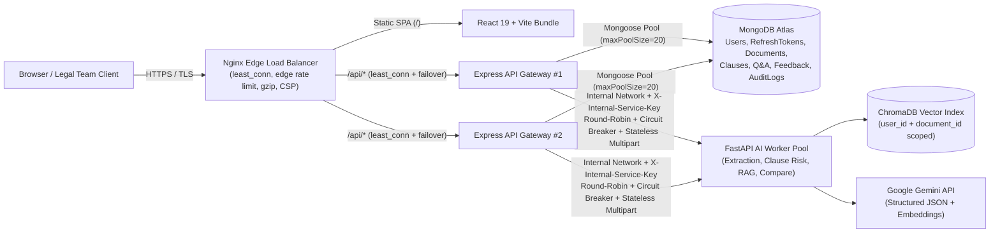

# System Design & Security Architecture

Legal Contract Agent is architected as a production, horizontally scalable, multi-tenant legal intelligence platform with strict separation between public edge routing, stateless API orchestration, and isolated internal AI compute.

## High-Level Topology

## Load Balancing & High Availability

1. **Edge Layer (`infra/nginx/load-balancer.conf`)**:
   - Uses `least_conn` upstream routing across stateless Express API replicas (`backend-1`, `backend-2`) with persistent `keepalive 32` upstream pools.
   - Passive health checks (`max_fails=3 fail_timeout=30s`) and `proxy_next_upstream error timeout http_502 http_503 http_504` automatically fail over requests away from degraded nodes.
   - Edge rate limiting (`auth_edge` 10 req/min, `api_edge` 60 req/min) and concurrent connection limits protect backend workers from volumetric abuse.
2. **Service-to-Service AI Pool (`backend/utils/aiClient.js`)**:
   - Accepts a comma-separated `AI_SERVICE_URLS` pool and distributes traffic with **health-aware round-robin**.
   - Maintains a per-node **Circuit Breaker** (`CLOSED` → `OPEN` after 3 consecutive failures → `HALF_OPEN` probe after 20s cooldown) with exponential-backoff retries across surviving nodes.
   - **Stateless File Streaming**: Contract binaries are streamed to AI workers over `multipart/form-data` (`/api/v1/extract`) rather than relying on local disk paths, allowing API gateways and AI workers to scale independently across hosts.
3. **Graceful Lifecycle & Probes**:
   - Exposes `/health/live` (liveness) and `/health/ready` (readiness verifying MongoDB + AI pool) on both Express and FastAPI.
   - Handles `SIGTERM`/`SIGINT` by draining in-flight HTTP requests before closing MongoDB connections.

## Authentication & Authorization Architecture

- **Dual-Token Session Design**:
  - **Access Token**: Short-lived (`15m`) HS256 JWT carrying `userId`, `role`, `tv` (monotonic `tokenVersion`), `jti`, `iss`, and `aud`.
  - **Refresh Token**: 48-byte cryptographically random secret stored as an `HttpOnly`, `SameSite=Strict/Lax`, `Secure` (production) cookie scoped to `/api/auth`, persisted in MongoDB only as a SHA-256 hash inside a token family (`RefreshToken` collection with TTL cleanup).
- **Rotation & Theft Detection**:
  - Every `POST /api/auth/refresh` atomically rotates the refresh token and invalidates its predecessor.
  - Replaying a revoked refresh token triggers **token family revocation** and logs a `token_reuse_detected` security audit event.
- **Instant Global Revocation**:
  - `POST /api/auth/logout-all` and `POST /api/auth/change-password` increment `User.tokenVersion`, instantly invalidating all outstanding JWT access tokens without needing a central blocklist lookup beyond the user record.
- **Brute-Force & Enumeration Defense**:
  - Constant-time dummy bcrypt comparison prevents email enumeration on `/api/auth/login`.
  - 5 consecutive failed sign-in attempts lock the account for 15 minutes (`423 Locked` + `Retry-After`).
- **Role-Based Access Control (RBAC) & Tenant Isolation**:
  - Roles: `reviewer`, `counsel`, `admin` enforced via `requireRole(...)`.
  - Every contract, clause, Q&A, feedback, and session query verifies `resource.user === req.user._id`.
  - Every vector index search and deletion passes strict tenant `user_id` filters to ChromaDB.

## Defense-in-Depth Security Controls

| Layer | Control | Implementation |
| --- | --- | --- |
| Network | Isolated internal AI subnet | `docker-compose.yml` `internal_net: internal: true`; AI port not published |
| Service Auth | Shared secret header | `X-Internal-Service-Key` constant-time `hmac.compare_digest` check on `/api/v1/*` |
| Input Validation | NoSQL & prototype pollution defense | `sanitizeRequest` strips `$` operators, `\0`, `__proto__`, `constructor` |
| File Uploads | Magic-byte signature inspection | Verifies `%PDF-`, `PK\x03\x04` (DOCX), non-binary TXT; cleans up orphans on failure |
| LFI Protection | Path jail on `/extract-path` | Resolves symlinks and restricts access to authorized upload directories |
| Prompt Injection | Untrusted document delimiters | Contract text wrapped in `<contract_excerpt>` / `<contract_document>` with strict grounding schema |
| Headers & CORS | Strict origin allowlist + Helmet | `CORS_ORIGINS` allowlist, HSTS, `X-Frame-Options: DENY`, `X-Content-Type-Options: nosniff` |
| Observability | Correlation IDs & Audit Trail | `X-Request-Id` end-to-end across Nginx → Express → FastAPI + immutable `AuditLog` |
