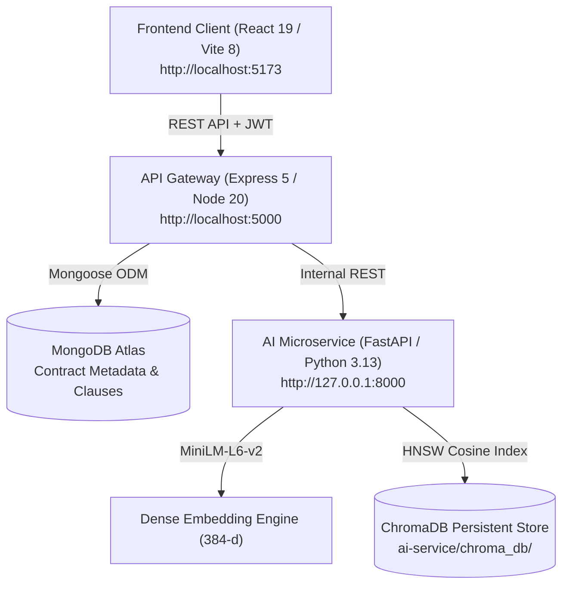

# Legal Contract Intelligence & Retrieval Platform

[](https://fastapi.tiangolo.com)
[](https://expressjs.com)
[](https://react.dev)
[](https://www.trychroma.com)
[](https://opensource.org/licenses/MIT)

A multi-tenant, privacy-first legal contract analysis platform featuring multi-format document ingestion, dense vector search, hybrid legal reranking, and source-grounded contract Q&A with clause citations.

---

## Architecture Overview

The system is architected as a full-stack microservices application separating client interaction, API orchestration, and high-performance vector processing:



---

## Core Features Implemented

### 1. Multi-Tenant Authentication & Privacy Boundaries
- JWT-based authentication with bcrypt password hashing (10 salt rounds).
- **Zero Cross-Tenant Leakage:** Every database document, clause extraction, and vector index query strictly enforces user ID ownership (`where={"user_id": userId}`).

### 2. Multi-Format Contract Ingestion & Extraction
- Supports `.pdf`, `.docx`, and `.txt` contracts up to 10MB.
- Layout-aware text extraction leveraging PyMuPDF (`fitz`) with automatic fallback to `pdfplumber`.
- Legal document cleaning: boilerplate reduction, page number normalization, and whitespace cleanup.
- Structural boundary chunking: preserves section headings, clause types, and page numbers.

### 3. Dense Vector Embeddings Pipeline
- 384-dimensional dense semantic vectors using `sentence-transformers/all-MiniLM-L6-v2`.
- Automatic device acceleration detection (`CUDA`, `Apple Silicon MPS`, or optimized `CPU`).
- Pre-computed L2 normalization for cosine similarity search.

### 4. ChromaDB Vector Store & Index Synchronization
- Provider-agnostic adapter interface (`BaseVectorStore`) enabling zero-friction switching between vector stores.
- Persistent local disk storage with HNSW indexing.
- Automated API synchronization: parsing a contract automatically embeds and indexes chunks; deleting a contract automatically purges vectors from ChromaDB.

### 5. Hybrid Legal Reranker
- Domain-specific cross-clause reranker combining:
  1. Dense semantic cosine similarity
  2. Legal taxonomy keywords (e.g., *indemnification*, *termination*, *governing law*, *liability*)
  3. Section heading priority scoring
  4. Exact token and phrase overlap

### 6. Grounded Contract Q&A with Structured Citations
- Retrieves top-$k$ relevant clauses and synthesizes grounded answers directly from the source contract.
- Provides citations for every claim: `Page Number`, `Section Heading`, `Clause Type`, and relevance confidence scores.

### 7. Confidence Verification & Out-of-Scope Defense
- Strict confidence threshold (`min_score = 0.25`).
- Out-of-scope or unrelated queries trigger a refusal flag (`insufficient_information: true`) with an explanation, preventing assumptions or hallucinations when factual evidence is absent.

### 8. Modern Responsive Frontend
- Dark-themed glassmorphism interface built with React 19 and custom CSS variables.
- Contract library dashboard with status indicators and indexed vector metrics.
- Global cross-contract semantic search bar with quick query chip presets.
- Interactive modal for clause inspection and grounded Q&A.

---

## Project Structure

```text
legal-contract-agent/
├── ai-service/                   # FastAPI Python Microservice
│   ├── extractors/               # PDF, DOCX, and TXT parsing engines
│   │   ├── base.py               # Abstract BaseExtractor class
│   │   ├── pdf_extractor.py      # PyMuPDF + pdfplumber extractor
│   │   ├── docx_extractor.py     # python-docx parser
│   │   ├── txt_extractor.py      # Plaintext extractor
│   │   └── utils.py              # Text cleaning & section detection
│   ├── services/                 # Core AI service layer
│   │   ├── embedding_service.py  # MiniLM-L6-v2 dense vectorizer
│   │   ├── extraction_service.py # Document parsing coordinator
│   │   ├── health_service.py     # System telemetry & device monitor
│   │   ├── retrieval_service.py  # Hybrid reranker & grounded Q&A
│   │   └── vector_store.py       # ChromaDB persistent store adapter
│   ├── tests/                    # Pytest unit & integration suite (32 tests)
│   ├── main.py                   # FastAPI application router & endpoints
│   └── requirements.txt          # Python dependencies
│
├── backend/                      # Node.js / Express API Gateway
│   ├── config/db.js              # MongoDB Atlas connection
│   ├── middleware/               # JWT authentication middleware
│   ├── models/                   # Mongoose schemas (User, Document, Clause)
│   ├── routes/                   # Auth and contract routes
│   └── server.js                 # Express server entry point (port 5000)
│
├── frontend/                     # React 19 / Vite Client Application
│   ├── src/
│   │   ├── context/              # Auth state context
│   │   ├── pages/                # Dashboard, Upload, Login, Register
│   │   ├── App.jsx               # Navigation & routing layout
│   │   └── index.css             # Design system styling tokens
│   └── vite.config.js            # Vite configuration (port 5173)
│
├── scripts/                      # Automation & testing utilities
│   ├── start-all.bat             # Windows one-click start script
│   ├── start-all.ps1             # PowerShell one-click start script
│   ├── test_e2e.js               # Full-stack integration test suite
│   └── verify_pipeline.py        # Vector search & retrieval verification
│
├── package.json                  # Root monorepo orchestration scripts
└── README.md                     # Platform documentation
```

---

## Getting Started

### Prerequisites

- **Node.js:** v20.x or higher
- **Python:** v3.11 or higher (managed via `uv` or standard `python -m venv`)
- **MongoDB:** MongoDB Atlas connection string or local MongoDB instance

---

### Installation

1. **Clone the repository:**
   ```bash
   git clone https://github.com/aparna-modi/legal-contract-agent.git
   cd legal-contract-agent
   ```

2. **Install Node.js dependencies:**
   ```bash
   npm install
   npm --prefix backend install
   npm --prefix frontend install
   ```

3. **Install Python dependencies:**
   ```bash
   cd ai-service
   uv sync
   # or with pip:
   # python -m venv .venv
   # source .venv/bin/activate  # On Windows: .venv\Scripts\activate
   # pip install -r requirements.txt
   cd ..
   ```

---

### Configuration (`.env`)

Create a `.env` file in `backend/.env`:

```env
PORT=5000
MONGO_URI=mongodb+srv://<username>:<password>@cluster.mongodb.net/legal-agent?retryWrites=true&w=majority
JWT_SECRET=your_jwt_secret_key_here
AI_SERVICE_URL=http://localhost:8000
```

---

### Running the Platform

#### Option A: One-Click Startup (All 3 Services)

Using npm:
```bash
npm run dev
```

Or on Windows:
```cmd
scripts\start-all.bat
```

#### Option B: Individual Services

| Service | Directory | Command | URL |
| :--- | :--- | :--- | :--- |
| **AI Microservice** | `ai-service/` | `uv run uvicorn main:app --port 8000 --reload` | `http://127.0.0.1:8000` (Docs: `/docs`) |
| **API Gateway** | `backend/` | `npm run dev` | `http://localhost:5000` |
| **Frontend Client** | `frontend/` | `npm run dev` | `http://localhost:5173` |

---

## API Reference

### AI Microservice (`http://127.0.0.1:8000`)

| Method | Endpoint | Description |
| :--- | :--- | :--- |
| `GET` | `/health` | Service health status and device accelerator info |
| `POST` | `/api/v1/extract` | Upload file for layout-aware chunking and extraction |
| `POST` | `/api/v1/embed` | Generate 384-d dense vector embeddings |
| `POST` | `/api/v1/similarity` | Calculate cosine similarity between two texts |
| `POST` | `/api/v1/vector/index` | Upsert chunk vectors with metadata and tenant scoping |
| `POST` | `/api/v1/vector/delete` | Delete vectors for a specific document or user |
| `GET` | `/api/v1/vector/stats` | Retrieve ChromaDB telemetry and user vector counts |
| `POST` | `/api/v1/retrieve` | Semantic retrieval with hybrid reranking and citations |

### API Gateway (`http://localhost:5000`)

| Method | Endpoint | Description |
| :--- | :--- | :--- |
| `POST` | `/api/auth/register` | Register new user account |
| `POST` | `/api/auth/login` | Authenticate user and return JWT |
| `POST` | `/api/contracts/upload` | Upload PDF/DOCX/TXT contract |
| `GET` | `/api/contracts` | List authenticated user's contracts |
| `POST` | `/api/contracts/:id/extract` | Trigger clause extraction & vector indexing |
| `GET` | `/api/contracts/:id/clauses` | Retrieve extracted clauses from database |
| `GET` | `/api/contracts/:id/summary` | Get contract metrics (page count, tokens, vector status) |
| `POST` | `/api/contracts/:id/ask` | Single-contract grounded Q&A with citations |
| `POST` | `/api/contracts/search` | Cross-contract library semantic search |
| `GET` | `/api/contracts/stats/vectors` | User-scoped vector collection metrics |
| `DELETE` | `/api/contracts/:id` | Delete contract and cascade-purge ChromaDB vectors |

---

## Testing & Verification

The platform includes comprehensive test suites across all tiers:

```bash
# 1. Run AI service unit and integration tests (32 tests)
npm run ai:test

# 2. Run vector pipeline verification
npm run test:pipeline

# 3. Run full-stack end-to-end integration test (15 scenarios, 63 assertions)
npm run test:e2e

# 4. Run all suites together
npm test
```

---

## License

This project is licensed under the MIT License.